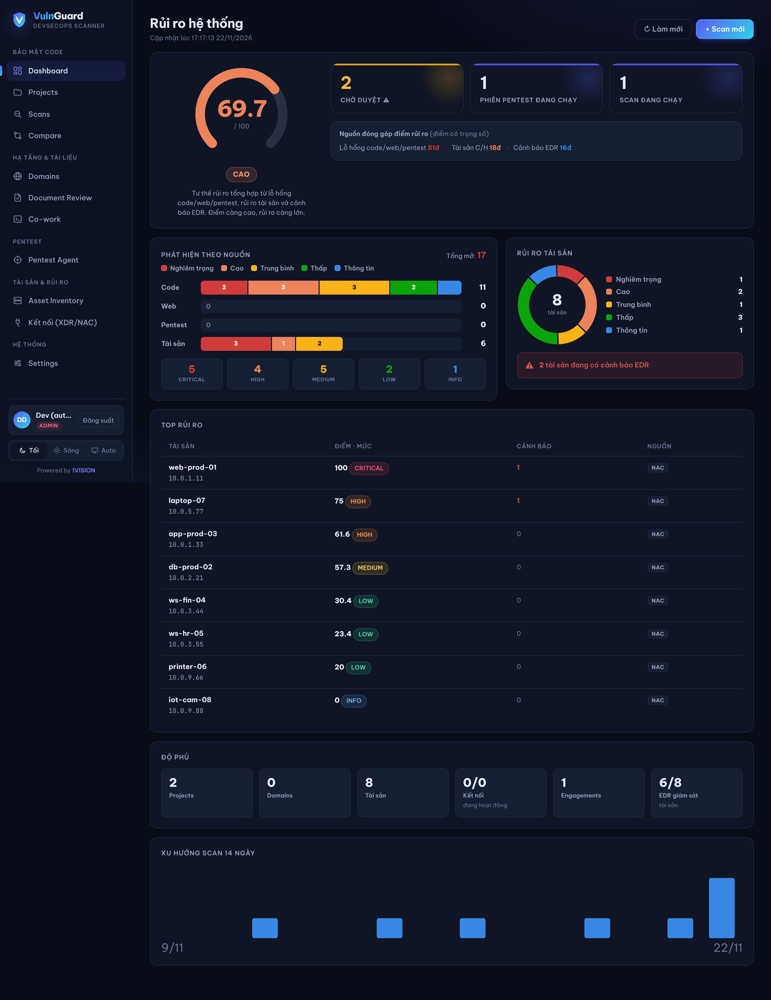
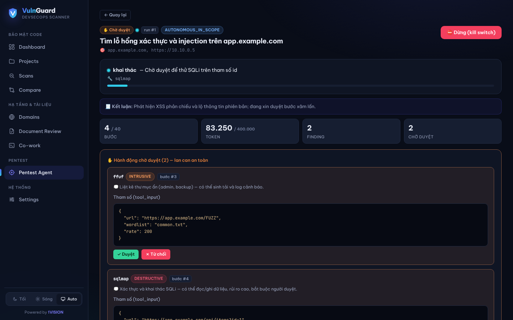
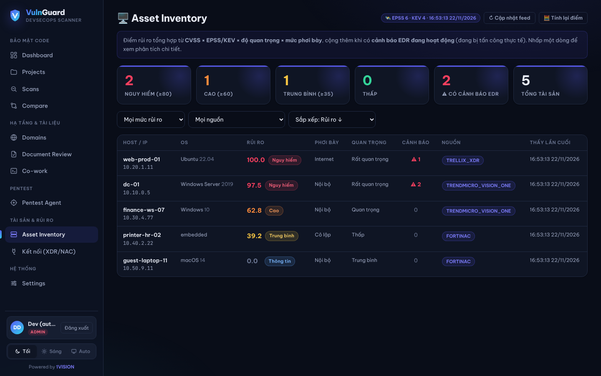
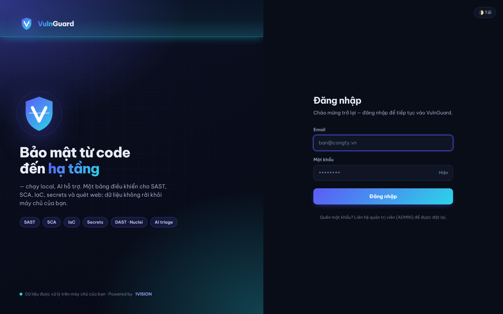

<div align="center">


# VulnGuard

**Bảo mật từ code đến hạ tầng — chạy local, AI hỗ trợ.**
_Security from code to infrastructure — local-first, AI-assisted._

Unified, local-first security platform: code · web · documents · automated pentest · context-aware asset & risk management — your data never leaves your machine.

**🌐 [English](#-english) · [Tiếng Việt](#-tiếng-việt)**

Powered by **[1VISION](https://1vision.work)**

</div>

<div align="center">

| Risk Dashboard | Pentest Agent |
| :---: | :---: |
|  |  |
| **Asset Inventory & Risk** | **Login** |
|  |  |

</div>

> ⚠️ The Pentest Agent is for assets you **own or are authorized to test**; every destructive action goes through human approval.
> Pentest Agent chỉ dùng cho tài sản **bạn sở hữu hoặc được uỷ quyền**; mọi hành động phá huỷ đều qua người duyệt.

---

# 🇬🇧 English

## What is VulnGuard?

VulnGuard runs entirely on your own machine and brings together, in one dashboard:

- 🔐 **Login & RBAC** — ADMIN / ANALYST / VIEWER roles, HttpOnly JWT sessions.
- 🤖 **AI analysis that cuts false positives** — local **Ollama**, or cloud **Claude API** (API key / Workload Identity Federation / environment) and **Amazon Bedrock** (AWS IAM — the platform Kiro uses). Three modes: *local-only · hybrid · cloud-only*.
- 🧰 **9+ scanners in parallel** — SAST, SCA, IaC, Container, Secrets, with cross-tool dedup.
- 🌐 **Web scanning (Nuclei)** on URLs discovered by the Katana crawler.
- 🎯 **Pentest Agent** — an autonomous, *controlled* planner/worker loop (Claude-driven) running real tools (nmap, nuclei, ffuf, sqlmap) behind scope/risk gates, approvals, budgets and a full audit trail. Findings carry real request/response evidence via a recording MITM proxy.
- 🗂️ **Asset inventory + context-aware risk scoring** (Tenable VPR / Nexpose style): `CVSS × EPSS × KEV × criticality × exposure`, boosted by active EDR alerts.
- 🔌 **XDR/EDR/NAC connectors** — Trellix XDR, Trend Micro Vision One, FortiNAC — plus an **MCP server** that exposes your data to agents / Claude Desktop.
- 📊 **System-wide risk dashboard** aggregating code + web + pentest + assets.
- 📑 **Document Review** of SRS/HLD/API specs against OWASP ASVS/SAMM.

## Quick Start — runs on **macOS · Linux · Windows**

A single cross-platform installer (`scripts/setup.py`) lets you choose Docker or Native, pick the tools you need, **auto-generates an ADMIN password**, and starts production at **http://localhost:8080**.

| OS | Command |
|---|---|
| **macOS / Linux** | `bash setup.sh` |
| **Windows** (PowerShell) | `powershell -ExecutionPolicy Bypass -File setup.ps1` |
| **Any OS** (Python) | `python3 scripts/setup.py` (Windows: `python scripts\setup.py`) |
| **Any OS** (Docker) | `bash setup.sh --docker` · or `docker compose up -d --build` |

Common flags: `--check` (list installed tools) · `--tools "sast sca web pentest" --no-run` (non-interactive) · `--docker` · `--admin-email you@corp.vn`. Re-run later with `bash run.sh` / `.\run.ps1`. Try the seeded **demo** with `bash run_demo.sh` (login `demo@vulnguard.local` / `VulnGuardDemo!`).

**Recommendations:** On **Windows**, Docker Desktop (`--docker`) is the fullest path (`semgrep` SAST needs Docker/WSL natively). On **macOS**, install Homebrew so the installer can fetch CLI tools. **Requirements:** Python 3.11+ (Native) or Docker. Scanner binaries are only needed for real scans — skip them if you only use the UI / Document Review.

## Integrated scanners

| Tool | Type | Scope |
|---|---|---|
| Semgrep / Bandit | SAST | Python, JS/TS, Java, Go, C… |
| Trivy / pip-audit | SCA | npm, pip, Maven, Go… (OSV, PyPI Advisory) |
| Checkov / Hadolint | IaC | Terraform, K8s, Dockerfile, CloudFormation |
| Grype | Container | CVEs in images & filesystems |
| Gitleaks / detect-secrets | Secrets | keys, tokens, high-entropy strings |
| Nuclei | DAST / Web | 10k+ templates (CVE, misconfig, exposure) |

The Pentest Agent additionally uses **katana** (crawl), **nmap**, **ffuf**, **sqlmap**.

## Highlighted features

- **Cloud AI to reduce false positives** — structured output + real code context around each finding; secrets redacted before leaving the machine; API keys encrypted (Fernet). "Re-analyze with Claude" per finding. Configure in *Settings → AI Provider* (ADMIN only).
- **Pentest Agent (controlled automation)** — **scope gate** (blocks out-of-scope & loopback), **risk gate** (recon/safe scans auto-run; intrusive/destructive need approval), authorization + expiry, step/token budgets, **kill switch**, audit trail. Durable attack chains (todolist), **parallel** tool execution. Evidence binding + recording **MITM proxy** (generated CA) + in-scope replay. → `docs/PENTEST_AGENT.md`
- **Context-aware risk** — the same CVE can score 100 on a critical/internet asset and ~6 on an isolated one. EPSS (FIRST) + CISA KEV feeds, cached offline. → `docs/CONNECTORS_MCP.md`
- **Connectors + MCP** — pull assets/alerts/software from XDR/EDR/NAC; encrypted secrets; add a vendor by writing one adapter. MCP server is read-only (host isolation still requires approval).

## API (summary)

`/api/auth/*` (login, RBAC, users) · `/api/ai/config` + `/api/vulns/{id}/reanalyze` · `/api/projects|scans|vulns|compare|report` · `/api/domains/{id}/webscans` · `/api/pentest/*` (engagements, runs, approvals, traffic, proxy) · `/api/assets` + `/api/intel` · `/api/connectors/*` · `/api/dashboard/overview`. Full Swagger at **http://localhost:8080/docs**.

## Security & privacy

- **Local by default** — scanners + Ollama run on your machine; nothing is sent out.
- **Auth + RBAC**; `setup.sh` auto-generates the ADMIN password (saved to `storage/admin_credentials.txt`, chmod 600 — change it then delete the file).
- **Secrets encrypted at rest** (Fernet): cloud AI keys, connector credentials — only hints are shown, never raw values.
- **Cloud AI is opt-in**; in hybrid/cloud mode only findings + redacted code context are sent.
- The **Pentest Agent** operates only within an authorized scope; destructive actions require approval.

## CI/CD (DevSecOps)

GitHub Actions close the loop: **`ci.yml`** runs the test suite and a **Bandit security gate** (fails the build on un-triaged HIGH findings) on every push/PR; **`security.yml`** dogfoods VulnGuard's own scanners (Bandit, Semgrep, pip-audit, Gitleaks, Trivy) and publishes a report artifact. Add VulnGuard to your pipeline by running `bash setup.sh --tools "..." --no-run` then your scan step, or wire the CLI into a job that fails on policy.

## Documentation

`docs/PENTEST_AGENT.md` · `docs/CONNECTORS_MCP.md` · `docs/BRAND.md` · `docs/NATIVE_INSTALL.md` · screenshots in `docs/screenshots/`.

---

# 🇻🇳 Tiếng Việt

## VulnGuard là gì?

VulnGuard chạy hoàn toàn trên máy của bạn và gom vào một bảng điều khiển:

- 🔐 **Đăng nhập & phân quyền (RBAC)** — vai trò ADMIN / ANALYST / VIEWER, session JWT cookie HttpOnly.
- 🤖 **AI phân tích giảm false positive** — **Ollama** local, hoặc **Claude API** (API key / Workload Identity Federation / environment) và **Amazon Bedrock** (AWS IAM — nền tảng Kiro dùng). 3 chế độ: *local-only · hybrid · cloud-only*.
- 🧰 **9+ scanner chạy song song** — SAST, SCA, IaC, Container, Secrets, gộp trùng cross-tool.
- 🌐 **Quét web (Nuclei)** trên URL do **Katana** crawl.
- 🎯 **Pentest Agent** — vòng lặp planner/worker tự động *có kiểm soát* (Claude lái), chạy công cụ thật (nmap, nuclei, ffuf, sqlmap) sau scope/risk gate, approval, budget và audit trail. Finding gắn bằng chứng request/response thật qua recording MITM proxy.
- 🗂️ **Asset inventory + risk scoring theo ngữ cảnh** (kiểu Tenable VPR / Nexpose): `CVSS × EPSS × KEV × độ quan trọng × mức phơi bày`, cộng khi có cảnh báo EDR đang hoạt động.
- 🔌 **Connector XDR/EDR/NAC** — Trellix XDR, Trend Micro Vision One, FortiNAC — kèm **MCP server** expose dữ liệu cho agent / Claude Desktop.
- 📊 **Dashboard rủi ro toàn hệ thống** gom code + web + pentest + tài sản.
- 📑 **Document Review** tài liệu SRS/HLD/API theo OWASP ASVS/SAMM.

## Quick Start — chạy trên **macOS · Linux · Windows**

Trình cài đặt chung đa nền tảng (`scripts/setup.py`): chọn Docker hoặc Native, tự chọn công cụ, **tự sinh mật khẩu ADMIN**, chạy production tại **http://localhost:8080**.

| OS | Lệnh |
|---|---|
| **macOS / Linux** | `bash setup.sh` |
| **Windows** (PowerShell) | `powershell -ExecutionPolicy Bypass -File setup.ps1` |
| **Mọi OS** (có Python) | `python3 scripts/setup.py` (Windows: `python scripts\setup.py`) |
| **Mọi OS** (Docker) | `bash setup.sh --docker` · hoặc `docker compose up -d --build` |

Cờ dùng chung: `--check` (liệt kê tool) · `--tools "sast sca web pentest" --no-run` (không tương tác) · `--docker` · `--admin-email you@corp.vn`. Chạy lại: `bash run.sh` / `.\run.ps1`. Bản **demo** có dữ liệu mẫu: `bash run_demo.sh` (đăng nhập `demo@vulnguard.local` / `VulnGuardDemo!`).

**Khuyến nghị:** Trên **Windows**, Docker Desktop (`--docker`) là cách đủ nhất (`semgrep` SAST cần Docker/WSL khi chạy native). Trên **macOS**, nên cài Homebrew để trình cài đặt lấy công cụ CLI. **Yêu cầu:** Python 3.11+ (Native) hoặc Docker. Công cụ quét chỉ cần khi quét thật — bỏ qua nếu chỉ dùng UI / Document Review.

## Scanner tích hợp

| Tool | Loại | Phạm vi |
|---|---|---|
| Semgrep / Bandit | SAST | Python, JS/TS, Java, Go, C… |
| Trivy / pip-audit | SCA | npm, pip, Maven, Go… (OSV, PyPI Advisory) |
| Checkov / Hadolint | IaC | Terraform, K8s, Dockerfile, CloudFormation |
| Grype | Container | CVE trong image & filesystem |
| Gitleaks / detect-secrets | Secrets | key, token, chuỗi entropy cao |
| Nuclei | DAST / Web | 10k+ template (CVE, misconfig, exposure) |

Pentest Agent dùng thêm **katana** (crawl), **nmap**, **ffuf**, **sqlmap**.

## Tính năng nổi bật

- **Cloud AI giảm false positive** — structured output + gửi ngữ cảnh code thật quanh dòng lỗi; **redact secret** trước khi gửi; API key **mã hoá Fernet**. Nút "Phân tích lại bằng Claude" cho từng vuln. Cấu hình ở *Settings → AI Provider* (chỉ ADMIN).
- **Pentest Agent (tự động có kiểm soát)** — **scope gate** (chặn ngoài phạm vi & loopback), **risk gate** (recon/quét an toàn tự chạy; xâm lấn/phá huỷ cần duyệt), uỷ quyền + hạn, budget bước/token, **kill switch**, audit trail. Chuỗi tấn công bền (todolist), chạy tool **song song**. Gắn bằng chứng + recording **MITM proxy** (CA tự sinh) + replay trong scope. → `docs/PENTEST_AGENT.md`
- **Risk theo ngữ cảnh** — cùng 1 CVE: máy critical/internet có thể 100đ, máy isolated chỉ ~6đ. Feed EPSS (FIRST) + CISA KEV, cache offline. → `docs/CONNECTORS_MCP.md`
- **Connectors + MCP** — kéo asset/alert/software từ XDR/EDR/NAC; secret mã hoá; thêm vendor = 1 adapter. MCP server read-only (cô lập host vẫn phải qua duyệt).

## API (tóm tắt)

`/api/auth/*` (đăng nhập, RBAC, user) · `/api/ai/config` + `/api/vulns/{id}/reanalyze` · `/api/projects|scans|vulns|compare|report` · `/api/domains/{id}/webscans` · `/api/pentest/*` (engagement, run, approval, traffic, proxy) · `/api/assets` + `/api/intel` · `/api/connectors/*` · `/api/dashboard/overview`. Swagger đầy đủ tại **http://localhost:8080/docs**.

## CI/CD (DevSecOps)

GitHub Actions khép vòng: **`ci.yml`** chạy bộ test + **gate bảo mật Bandit** (fail build nếu có lỗ hổng HIGH chưa triage) ở mỗi push/PR; **`security.yml`** tự quét chính dự án bằng đúng bộ công cụ VulnGuard tích hợp (Bandit, Semgrep, pip-audit, Gitleaks, Trivy) và xuất báo cáo artifact. Nhúng vào pipeline của bạn: `bash setup.sh --tools "..." --no-run` rồi thêm bước scan, hoặc dùng CLI trả exit-code theo policy.

## Bảo mật & Privacy

- **Mặc định hoàn toàn local** — scanner + Ollama chạy tại chỗ, không gửi gì ra ngoài.
- **Đăng nhập + RBAC**; `setup.sh` tự sinh mật khẩu ADMIN (lưu `storage/admin_credentials.txt`, chmod 600 — đổi rồi xoá file).
- **Secret mã hoá at-rest** (Fernet): key cloud AI, credential connector — chỉ hiện hint, không lộ raw.
- **Cloud AI là opt-in**; chế độ hybrid/cloud chỉ gửi finding + ngữ cảnh code đã redact.
- **Pentest Agent** chỉ chạy trong scope đã uỷ quyền; hành động phá huỷ qua người duyệt.

## Cấu hình `.env` (tuỳ chọn)

```bash
VULNGUARD_PORT=8080
OLLAMA_MODEL=llama3.2
OLLAMA_TIMEOUT=120
AUTH_ENABLED=true
VULNGUARD_SECRET_KEY=        # trống = tự sinh storage/secret.key
SESSION_TTL_HOURS=12
COOKIE_SECURE=false          # true khi sau HTTPS
MAX_SCANS_PER_PROJECT=5
BLOCK_SEVERITY_THRESHOLD=HIGH
MAX_WEBSCANS_PER_DOMAIN=5
NUCLEI_TIMEOUT_MINUTES=60
PENTEST_PROXY_PORT=8788
```

> **Cloud AI** (Claude API key / WIF / Bedrock) cấu hình trong **Settings → AI Provider** (mã hoá at-rest), không qua `.env`.

## Cấu trúc Project

```
VulnGuard/
├── setup.sh · setup.ps1 · run.sh · run.ps1 · run_demo.sh   # cài & chạy đa nền tảng
├── scripts/            # setup.py (installer chung), bootstrap_admin.py, seed_demo.py
├── docker-compose.yml  · .env.example · .env.native.example
├── api/
│   ├── main.py config.py database.py security.py          # app + auth/mã hoá
│   ├── *_models.py  schemas.py                             # Project/Scan/Vuln, Asset, Pentest, Connector…
│   └── routes/         # auth, ai, projects, scans, vulns, webscans, domains,
│                       # pentest, assets, intel, connectors, dashboard, docreview…
├── scanner/
│   ├── orchestrator.py ai_analyzer.py cloud_ai.py          # scan engine + AI (local/cloud)
│   ├── scanners/ crawler/ intel/ assets/ connectors/ pentest/
├── mcp_server/server.py   # MCP server
├── web/                   # index.html (SPA), login.html, agent.html, brand.css
├── docs/                  # PENTEST_AGENT, CONNECTORS_MCP, BRAND, screenshots
└── storage/               # SQLite, config, secret.key, pentest_ca, intel cache
```

## Troubleshooting

```bash
# Kiểm tra công cụ đã cài / Check installed tools
bash setup.sh --check            # Windows: .\setup.ps1 --check

# AI local không kết nối / Local AI not connecting
ollama list && curl http://localhost:11434/api/tags
ollama serve

# Rebuild Docker
docker compose down && docker compose build --no-cache && docker compose up -d
```

---

<div align="center">

_Generated by [Claude Code](https://claude.ai/code) · Powered by [1VISION](https://1vision.work)_

</div>
