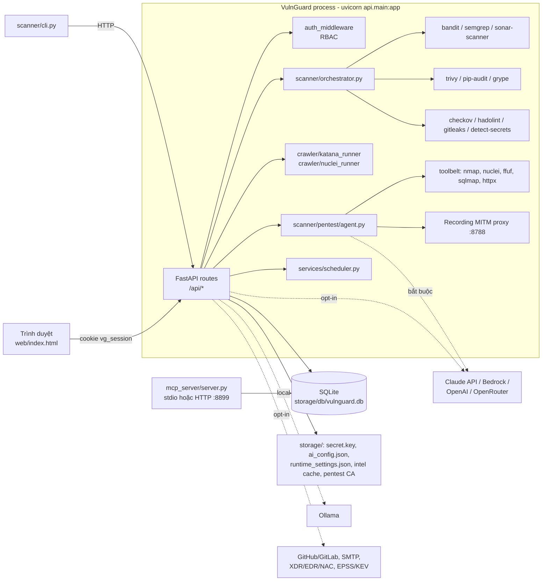

# VulnGuard Wiki

**VulnGuard** là nền tảng bảo mật chạy trên máy của bạn (local-first): quét mã nguồn, quét web, Pentest Agent có kiểm soát, quản lý tài sản và rủi ro, có AI hỗ trợ giảm false positive. Wiki này mô tả đúng những gì có trong mã nguồn ở commit `1e0e810` (nhánh `main`, 24/11/2026).

> Pentest Agent, web scan và crawl chỉ dùng cho tài sản **bạn sở hữu hoặc được uỷ quyền**. Xem [[Security and Known Limitations|Security-and-Known-Limitations]].

## Tính năng chính

| Nhóm | Có gì trong code |
|---|---|
| Đăng nhập & phân quyền | 3 vai trò `ADMIN` / `ANALYST` / `VIEWER`, session JWT (cookie HttpOnly `vg_session` hoặc header `Authorization: Bearer`) |
| Quét mã nguồn | 5 loại scan `SAST`, `SCA`, `SECRETS`, `IAC`, `CONTAINER` với Bandit, Semgrep, SonarQube, Trivy, pip-audit, Checkov, Hadolint, Grype, Gitleaks, detect-secrets. Chạy song song, gộp trùng theo fingerprint |
| Triage kiểu Checkmarx | Trạng thái `OPEN`, `CONFIRMED`, `URGENT`, `PROPOSED_NE`, `NOT_EXPLOITABLE`, `ACCEPTED`, `FIXED`; kế thừa triage giữa các lần scan; audit trail |
| Quét web | Crawl bằng Katana, quét bằng Nuclei, kiểm security header. Bắt buộc xác minh quyền sở hữu domain |
| Pentest Agent | Vòng lặp tool-use do Claude điều khiển, gồm `http_probe`, `dns_resolve`, `port_scan` (nmap), `web_vuln_scan` (nuclei), `content_discovery` (ffuf), `active_http`, `nuclei_dast`, `sqlmap`, `asset_context`. Có scope gate, risk gate, approval, budget, kill switch |
| Bằng chứng | Recording MITM proxy (CA tự sinh), lưu request/response, replay trong scope |
| Tài sản & rủi ro | Asset inventory, risk score `CVSS × EPSS/KEV × criticality × exposure`, connector Trellix XDR, Trend Micro Vision One, FortiNAC |
| MCP server | 7 tool read-only, chạy stdio hoặc HTTP (HTTP bắt buộc token) |
| Báo cáo | PDF (tiếng Việt), Markdown, AI-JSON, SARIF, JSON, CSV, báo cáo HTML, ánh xạ tuân thủ OWASP / ISO 27001 / TCVN 11930 / PCI-DSS |
| SCM | Kết nối GitHub / GitLab (cloud và self-hosted), scan tay hoặc theo lịch, gửi báo cáo qua SMTP |
| Module khác | Document Review (SRS/HLD/API spec), File Assistant, Co-work (AI sửa code qua `coworker_host`). Có thể tắt bằng feature flag |

## Kiến trúc



## Bắt đầu nhanh

```bash
git clone https://github.com/datntpro/VulnGuard.git && cd VulnGuard
bash setup.sh --mode native --tools sast,sca,secrets --no-run   # cài, tạo ADMIN
bash run.sh                                                     # chạy tại http://127.0.0.1:8080
```

Mật khẩu ADMIN nằm trong `storage/admin_credentials.txt` (chmod 600). Đăng nhập, đổi mật khẩu, rồi xoá file. Chi tiết ở [[Installation]].

## Mục lục

- [[Installation]]: yêu cầu, cài Native / Docker / systemd / demo
- [[Configuration]]: biến môi trường, AI provider, Ollama, SonarQube, SMTP, cổng, binding
- [[Features]]: tính năng theo nhóm
- [[Authentication and Roles|Authentication-and-Roles]]: đăng nhập, RBAC, phiên
- [[Security and Data Flow|Security-and-Data-Flow]]: cơ chế bảo vệ, dữ liệu nào rời máy
- [[Scanning and Triage|Scanning-and-Triage]]: quét SAST / SCA / Secrets / IaC / Container, triage, so sánh scan
- [[Web Scanning|Web-Scanning]]: xác minh domain, crawl Katana, quét Nuclei
- [[Pentest Agent|Pentest-Agent]]: engagement, scope gate, risk gate, approval, MITM proxy
- [[MCP Server|MCP-Server]]: stdio / HTTP, danh sách tool
- [[Assets and Connectors|Assets-and-Connectors]]: asset inventory, risk scoring, XDR/EDR/NAC, EPSS/KEV
- [[SCM Integration|SCM-Integration]]: GitHub / GitLab, quét theo lịch, gửi báo cáo
- [[Compliance]]: OWASP / ISO 27001 / TCVN 11930 / PCI-DSS, SARIF
- [[Reports and Exports|Reports-and-Exports]]
- [[API Reference|API-Reference]]
- [[Security and Known Limitations|Security-and-Known-Limitations]]: hạn chế đã kiểm chứng trong code
- [[Truy cập từ máy khác trong LAN|LAN-Access]]
- [[Troubleshooting]]
- [[FAQ]]

## Giấy phép

AGPL-3.0-only (bản Community, file `LICENSE`) kèm lựa chọn giấy phép thương mại (`COMMERCIAL-LICENSE.md`), điều khoản sử dụng ở `EULA.md`, giấy phép bên thứ ba ở `THIRD_PARTY_LICENSES.md`.
